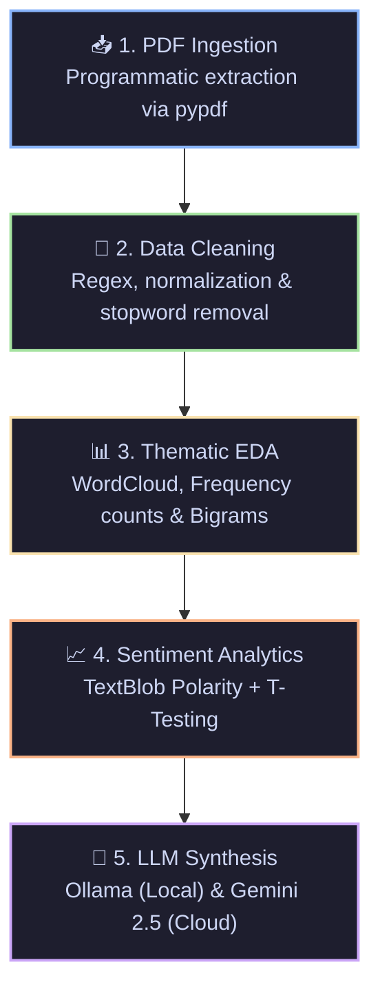

# **Indian Union Budget 2022–2023: NLP & Multi-LLM Analysis**

---

## 🏛️ 1. General Intro About the Budget

The **Union Budget of India** (mandated under Article 112 of the Constitution as the *Annual Financial Statement*) is the nation’s most definitive economic policy document. Presented annually by the Union Finance Minister, it delineates the government's estimated revenues, expenditure obligations, and strategic fiscal priorities for the coming fiscal year.

### 📌 Context of Budget 2022–2023 (*The Dawn of Amrit Kaal*)
* **Delivered By:** **Smt. Nirmala Sitharaman** (Hon’ble Union Minister of Finance and Corporate Affairs).
* **Date & Delivery:** **February 1, 2022 (Tuesday)** at 11:00 AM IST in the Lok Sabha, Parliament House, New Delhi.
* **Duration:** Approximately **91 to 92 minutes** (~1 hour 31 minutes).
* **Strategic Milestone:** Delivered during India’s 75th year of Independence (*Azadi Ka Amrit Mahotsav*), this budget laid the foundational 25-year roadmap leading up to **India @ 100**, officially introducing the national concept of **"Amrit Kaal"**.
* **The 4 Guiding Pillars:** Rather than isolated sector spending, the speech was systematically built upon four central growth engines:
  1. **PM GatiShakti** (7 Engines: Roads, Railways, Airports, Ports, Mass Transport, Waterways, Logistics Infrastructure).
  2. **Inclusive Development** (Agriculture, *Har Ghar Nal Se Jal*, *PM Awas Yojana*, Kisan Drones).
  3. **Productivity Enhancement & Sunrise Opportunities** (5G auctions, PLI schemes, Sovereign Green Bonds, EV Battery Swapping).
  4. **Financing of Investments** (Historic 35.4% jump in public CapEx to ₹7.50 Lakh Crore).

---

## 🎯 2. Problem Statement in Concise

Public understanding of the Union Budget is frequently distorted by **media sensationalism and polarized political discourse**. Following the 2022–23 speech, government narratives hailed it as a visionary *Amrit Kaal growth engine*, whereas opposition benches and consumer headlines labeled it a *zero-sum, pro-corporate budget* that neglected immediate inflation, middle-class tax cuts, and rural employment.

**The Analytical Problem:** How can we bypass external subjective bias, selective journalistic quoting, and political rhetoric to extract the **unvarnished, mathematical truth** regarding what the government truly emphasized, how its linguistic tone evolved, and where public money was allocated?

---

## ⚙️ 3. Process We Follow

To solve this problem objectively, we engineered an automated, reproducible end-to-end data pipeline:

1. **Automated Extraction:** Programmatically download and extract verbatim text from the official 38-page Parliamentary document (`Budget_Speech.pdf`) using `requests` and `pypdf`, yielding **926 analyzed paragraph units**.
2. **Text Preprocessing & Cleaning:** Filter out common English stopwords, parliamentary ceremonial honorifics (*Madam Speaker*, *Hon'ble*, *Sir*), measurement units (*crores*, *lakhs*), and punctuation to isolate pure semantic tokens.
3. **Exploratory Data Analysis (EDA):** Generate high-resolution WordClouds, compute top 10 unigram frequencies, and extract top 10 co-occurring bigrams (two-word phrases) using `NLTK`.
4. **Sentiment & Tone Trajectory:** Compute paragraph-level sentiment polarity scores using `TextBlob` ($-1.0$ to $+1.0$), plot the emotional trajectory across the speech, and conduct an **Independent Two-Sample T-Test** between the first half (Part A: Vision) and second half (Part B: Tax).
5. **Multi-Model LLM Extraction:** Benchmark lightweight local models (`Phi-3`, `Llama 3.1`, `Qwen2` via Ollama) and cloud inference (`Google Gemini 2.5 Flash`) to parse complex unstructured text into three structured financial tables (*Sector Allocations*, *Rupee Inflow*, *Rupee Outflow*).

---

## 💡 4. Why We Have Done

1. **Empirical Fact-Checking:** Speeches often use political buzzwords that obscure actual policy weighting. Frequency analysis quantifies whether high-profile topics like *"Crypto"* or *"CapEx"* genuinely dominated the speech.
2. **Measuring Linguistic Discipline:** By analyzing sentiment trajectory and applying hypothesis testing ($p$-value), we statistically measure whether the Finance Minister maintains a constructive reform tone or transitions into defensive, legalistic jargon during tax proposals.
3. **Structured Non-Hallucinatory Extraction:** Parsing multi-lakh-crore allocations from unstructured narrative text is error-prone. Constrained LLM prompting forces language models to act as deterministic financial auditors directly over source text.
4. **Reproducible Open-Source Standard:** Establishing a standard NLP template that can benchmark any year’s budget speech against historical records without requiring manual document review.

---

## 📊 5. What We Infer

From the execution of the notebook over the 2022–23 text corpus, we derive the following mathematical and economic findings:

### A. Dominant Unigrams & Bigrams
* **Top 10 Keywords:** `capital` (33), `digital` (30), `development` (26), `investment` (25), `tax` (25), `infrastructure` (24), `customs` (22), `india` (22), `income` (21), `energy` (20).
  * *Inference:* The vocabulary reveals an overwhelming emphasis on **supply-side capital creation (`capital`, `investment`, `infrastructure`)** and modernization (`digital`, `energy`), firmly validating the government's claimed pivot toward asset-building over consumption subsidies.
* **Top 10 Bigrams:** `virtual digital` (8), `capital goods` (8), `capital investment` (7), `climate action` (6), `amrit kaal` (6), `public investment` (6), `customs duty` (6), `productivity enhancement` (5), `energy transition` (5).
  * *Inference:* The co-occurrence reveals the true regulatory anchors of 2022—namely, the landmark formalization of a **30% tax on Virtual Digital Assets (Crypto / NFTs)** and the **phasing out of project-import customs exemptions on capital goods** to protect domestic manufacturers.

### B. Speech Tone Dynamics & The T-Test Anomaly
* **Total Paragraphs Evaluated:** 926
* **Overall Mean Polarity:** `+0.033` (Balanced & Measured)
* **First Half (Part A):** `+0.037`
* **Second Half (Part B):** `+0.029`
* **T-Statistic:** `0.8102` | **P-Value:** `0.4180` ($p > 0.05$)
* *Major Finding:* Unlike subsequent budgets (such as 2023–24 and 2024–25, which showed statistically significant tone drops in Part B), **Budget 2022–23 exhibited no statistically significant difference in tone ($p = 0.4180$)**. The Finance Minister maintained an unusually steady, uniform, and disciplined delivery throughout both the macro-policy announcements and technical tax amendments.

---

## 📑 6. Total Summary

The quantitative LLM extraction synthesized the full parliamentary text into three core operational matrices:

### 1️⃣ Sector-Wise Allocations & Major Announcements

| Sector | Key Announcements & Allocations |
| :--- | :--- |
| **🌾 Agriculture & Farmers** | • **₹2.37 lakh crore** direct MSP transfer to 163 lakh farmers for wheat/paddy procurement. • Promotion of chemical-free natural farming along the river Ganga corridor and support for millets. • PPP rollout of digital & hi-tech services including **Kisan Drones** for crop assessment and land record digitization. • **Ken-Betwa River Interlinking:** ₹1,400 crore allocated in 2022–23 (total project cost: ₹44,605 Cr). |
| **🎓 Education & Skills** | • **PM eVIDYA:** ‘One Class-One TV Channel’ expanded from 12 to **200 TV channels** for regional education (classes 1–12). • 750 virtual science/math labs and 75 vocational skilling e-labs established. • Rollout of **DESH-Stack e-portal** for digital credentials and establishment of a world-class **Digital University**. |
| **🏥 Health & Wellness** | • Open platform for the National Digital Health Ecosystem rolled out under Ayushman Bharat. • Launch of the **National Tele Mental Health Programme** with 23 centres of excellence, led by NIMHANS. |
| **🚆 Railways & Transport** | • **PM GatiShakti:** National Highways network expanded by **25,000 km** in 2022–23 (₹20,000 Cr mobilized). • Manufacturing of **400 new-generation Vande Bharat trains** and **100 PM GatiShakti Cargo Terminals** in 3 years. • 2,000 km of railway tracks brought under indigenous **Kavach** safety technology. |
| **🤖 Technology & AI** | • Commercial **5G spectrum auctions** conducted to facilitate telecom rollout in 2022–23. • Introduction of the **Digital Rupee (CBDC)** by the RBI using blockchain architecture. • Optical fibre contracts under BharatNet in all villages via PPP, targeting 2025 completion. |
| **🛡️ Defence & Security** | • **68% of capital procurement budget** earmarked for domestic industry (up from 58% in 2021–22). • 25% of defence R&D budget opened up to private industry, startups, and academia. |
| **👩 Women / Nari Shakti** | • Launch of revamped missions: *Mission Shakti*, *Mission Vatsalya*, and *Saksham Anganwadi & Poshan 2.0*. • Upgradation of **2 lakh anganwadis** with clean energy and improved learning infrastructure. |
| **💼 Youth & Employment** | • PLI schemes across 14 sectors projected to generate **60 lakh new jobs** and ₹30 lakh crore production. • Setting up of an **AVGC Promotion Task Force** (Animation, Visual Effects, Gaming, and Comic) for youth employment. |
| **🚀 Startups & MSME** | • **ECLGS extended to March 2023**, with cover expanded by ₹50,000 Cr to **₹5 lakh crore** (focused on hospitality). • **CGTMSE revamped** to unlock ₹2 lakh crore in additional collateral-free credit. • 3-year consecutive tax holiday eligibility for startups extended by 1 year to March 31, 2023. |
| **🏗️ Infrastructure** | • **Public CapEx:** Hiked by **35.4% to ₹7.50 lakh crore** (2.9% of GDP); Effective CapEx at ₹10.68 lakh crore. • **Har Ghar, Nal Se Jal:** **₹60,000 crore** allocated to connect 3.8 crore households. • **PM Awas Yojana:** **₹48,000 crore** allocated to construct 80 lakh affordable homes. • **PM-DevINE:** Initial allocation of ₹1,500 crore for North-East infrastructure and livelihood projects. |

---

### 2️⃣ The 'Rupee Comes From' Analysis (Revenue Profile)

| Revenue Head | Details & Policy Changes (BE 2022–23) |
| :--- | :--- |
| **Total Non-Borrowing Receipts** | **₹22.84 lakh crore** (Estimated) |
| **Fiscal Deficit Target** | Pegged at **6.4% of GDP** (Glide path committed to reducing below 4.5% by FY 2025–26) |
| **Direct Taxes — Key Policy Shifts** | • **Updated Return (ITR-U):** Citizens allowed to file updated tax returns within **2 years** from the relevant assessment year to correct reporting errors. • **Virtual Digital Assets:** Flat **30% tax on Crypto/NFT profits** + **1% TDS** on transactions; no expense deduction except acquisition cost; losses cannot offset other income. • **Cooperative Societies:** AMT rate slashed from 18.5% to **15%**; surcharge capped at 7% for incomes between ₹1 Cr and ₹10 Cr. • **State Employees NPS Parity:** Employer contribution deduction limit raised from 10% to **14%** (matching Central Government employees). • **Anti-Avoidance:** Health & Education Cess clarified as strictly non-deductible as business expenditure. |
| **Indirect Taxes (GST & Customs)** | • **Project Import Reforms:** Concessional duty rates on capital goods phased out, applying a uniform moderate rate of **7.5%** to encourage domestic capital equipment manufacturing. • **Exemption Pruning:** Over **350 customs duty exemptions phased out**. • **Gems & Jewellery:** Duty on cut/polished diamonds reduced to **5%**; duty on imitation jewellery set to minimum ₹400/kg. • **Fuel Blending Incentive:** Additional differential excise duty of **₹2/litre** levied on unblended fuel from October 1, 2022. |

---

### 3️⃣ The 'Rupee Goes To' Analysis (Expenditure Profile)

| Expenditure Head | Details & Allocations (BE 2022–23) |
| :--- | :--- |
| **Total Budgeted Expenditure** | **₹39.45 lakh crore** |
| **Public Capital Outlay (CapEx)** | **₹7.50 lakh crore** *(+35.4% YoY increase, 2.9% of GDP)*; Effective CapEx: **₹10.68 lakh crore (4.1% of GDP)**. |
| **Subnational Capital Assistance** | **₹1,00,000 crore** provided via **50-year interest-free loans** to state governments to spur regional capital investments. |
| **Key Flagship Programs** | • **Har Ghar, Nal Se Jal:** ₹60,000 crore • **PM Awas Yojana:** ₹48,000 crore • **National Highways Expansion:** ₹20,000 crore mobilized through innovative market finance • **Solar PV Modules (PLI):** ₹19,500 crore additional allocation • **RAMP Programme (MSME):** ₹6,000 crore over 5 years • **Ken-Betwa Project:** ₹1,400 crore allocation • **PM-DevINE (North-East):** ₹1,500 crore initial allocation |

---

### 🏁 Final Takeaway
Budget 2022–23 marked a decisive structural departure from pre-election consumption populism. Through an unprecedented **₹7.50 Lakh Crore CapEx drive**, regulatory frameworks for **Crypto & CBDC**, and comprehensive logistics integration under **PM GatiShakti**, the government positioned public infrastructure investment as the primary engine to pull the Indian economy into the **Amrit Kaal** era.
