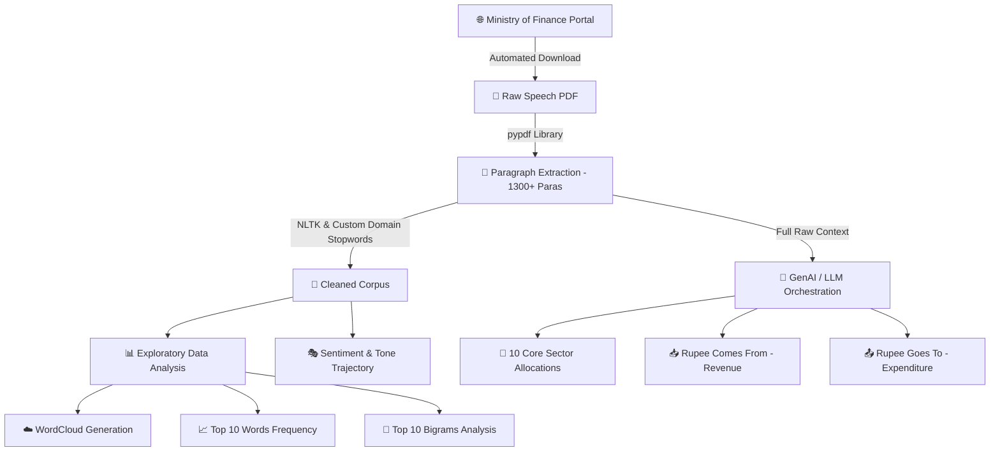

# 📊 Indian Union Budget 2024–25 (Interim) Analysis using NLP & GenAI

[](https://www.python.org/)
[](https://www.nltk.org/)
[](https://ai.google.dev/)
[](https://jupyter.org/)
[](https://opensource.org/licenses/Apache-2.0)

> 🇮🇳 **Decoding India's Economic Blueprint:** An end-to-end Natural Language Processing (NLP) and Generative AI framework to parse, clean, and extract granular sectoral insights, fiscal metrics, and policy directions from the **Interim Union Budget Speech 2024–25**.


---

## 🎯 Motivation & Problem Statement

Delivered by the Hon'ble Finance Minister, the **Union Budget of India** sets the macroeconomic narrative, resource allocations, and investment priorities for the nation. However, manually analyzing a 30 to 40-page technical speech loaded with statutory jargon and numbers can be overwhelming.

**Project Objective:**  
Bypass media interpretation and noise by applying **computational text mining** and **Large Language Models (LLMs)** directly on the authentic parliamentary text to uncover:
1. 🌾 Dominant sectoral focus areas (Agriculture, Infrastructure, Youth, MSMEs, etc.).
2. 📈 Linguistic frequency distributions via WordClouds and N-gram models.
3. 💰 Granular fiscal breakdowns of sovereign revenue (*"Where the Rupee Comes From"*) and expenditure (*"Where the Rupee Goes To"*).

---

## 🏛️ The 2024 Context: What is an Interim Budget?

Since **2024 was a General Lok Sabha Election year**, two separate budgets were tabled in Parliament:

| Dimension | 🗳️ Interim Budget (February 2024) | 📜 Full Budget (July 2024) |
| :--- | :--- | :--- |
| **Constitutional Basis** | **Article 116** (*Vote on Account*) | **Article 112** (*Annual Financial Statement*) |
| **Primary Purpose** | Fund essential state machinery for 2–4 months | Comprehensive 12-month fiscal & policy roadmap |
| **Policy Scope** | Administrative continuity; **no major tax overhauls** | Major direct/indirect tax reforms & new schemes |
| **Corpus Tone** | Retrospective decade review + *Viksit Bharat 2047* vision | Granular allocative budget & statutory Finance Bill |

> 📌 *This repository focuses on the primary text of the **Interim Budget 2024–25**, presented on **February 1, 2024**, by **Smt. Nirmala Sitharaman** in the Lok Sabha (Duration: ~56 minutes).*

---

## 🧠 Concept Explainer: Kiska Kya Matlab Hai?

Agar aap is project ke NLP aur Data Science concepts ko samajhna chahte hain, toh yahan har technique ka exact purpose explain kiya gaya hai:

### 1. ☁️ WordCloud (Visual Frequency Heatmap)
* **Kyu use kiya?** Ek 40-page ke document me sabse zyada bole gaye shabd kaunse hain, ye ek jhalak me dekhne ke liye.
* **Kaise kaam karta hai?** Jis shabd ki frequency jitni zyada hoti hai, uska font size WordCloud me utna hi bada dikhta hai.
* **Significance:** Isse pata chalta hai ki sarkar ka primary focus *Infrastructure* par tha, *Agriculture* par tha, ya *Fiscal Deficit* par.

### 2. 🔗 Bigrams & N-Grams (Contextual Phrases)
* **Kyu use kiya?** Single words aksar misleading hote hain. Example: Sirf `"Tax"` dekh kar pata nahi chalta ki baat kis baare me hai.
* **Kaise kaam karta hai?** Do lagataar aane wale shabdon ki jodi (*Bigrams*) analyze ki jaati hai (jaise `"Direct Tax"`, `"Green Energy"`, `"Nano DAP"`).
* **Significance:** Ye single words ke muqable asli contextual meaning aur scheme ke naam reveal karta hai.

### 3. 🎭 Sentiment & Tone Analysis (Economic Psychology)
* **Kyu use kiya?** Speech ke andar chhupi hui emotional aur economic tone ko quantify karne ke liye.
* **Ye 3 Tones kya batate hain?**
  * 🟢 **Optimistic (Growth-oriented):** Sarkar economic growth, investments, aur future targets ko lekar confident hai.
  * ⚪ **Neutral (Factual/Allocative):** Numbers, budgetary tables, legal provisions aur factual grants.
  * 🔴 **Cautious (Fiscal Prudence):** Geopolitical tensions, inflation, supply chain bottlenecks, ya fiscal deficit ke risks par alert hona.

### 4. 🤖 Zero-Shot LLM Extraction (Granular Intelligence)
* **Kyu use kiya?** NLP counts sirf shabd ginte hain, par exact numbers (jaise ₹11.11 lakh crore capex) ko tabular format me convert nahi kar sakte.
* **Kaise kaam karta hai?** State-of-the-art LLMs (Gemini / Groq Llama-3.3) ko tailored prompt dekar poore speech corpus se structured Markdown tables extract karwayi jaati hain bina kisi hallucination ke.

---

## 🔄 End-to-End Pipeline & Flow



1. **Document Ingestion:** Official portal se `Budget_Speech_2024-25.pdf` fetch karna aur page-by-page paragraph array (`li`) me extract karna.
2. **Noise Filtration:** Legal jargon (`section`, `sub-clause`), parliamentary formalities (`madam speaker`, `honble`), aur monetary units (`crore`, `lakhs`) ko filter out karna.
3. **Statistical Text Mining:** Tokenization ke baad frequency distributions aur graphical bar plots banana.
4. **Structured Information Extraction:** LLMs ke through speech ke *Receipts*, *Expenditure*, aur *Priority Sectors* ko clean tables me tabulate karna.

---

## 📊 Key Findings & Strategic Insights

### 1. Sector-Wise Allocations (Top Focus Areas)

| 🏷️ Sector | 📌 Key Strategic Highlights |
| :--- | :--- |
| **🌾 Agriculture & Farmers** | • Expansion of **Nano-DAP** across all agro-climatic zones.<br>• Launch of *Atmanirbhar Oilseeds Abhiyan* (mustard, groundnut, sesame, sunflower).<br>• Comprehensive support for dairy farmers & *PM Matsya Sampada Yojana*. |
| **🏗️ Infrastructure** | • Historic **₹11,11,111 crore** (₹11.11L Cr) Capex outlay (**3.4% of GDP**).<br>• *PM Surya Ghar:* Rooftop solarization for 1 crore households (up to 300 free units/month). |
| **🚆 Railways & Transit** | • 3 major *PM Gati Shakti* economic rail corridors.<br>• Upgradation of **40,000 standard rail bogies** to Vande Bharat standards. |
| **💡 Technology & Innovation** | • **₹1 lakh crore** innovation corpus with **50-year interest-free loans** for sunrise sectors.<br>• Institutionalization of *Digital Public Infrastructure (DPI)* as a modern factor of production. |
| **👩 Women Empowerment** | • Target enhanced to **3 crore *Lakhpati Didis*** via 83 lakh SHGs.<br>• Over **70% of PM Awas Yojana (Rural)** houses allotted to women as sole/joint owners. |
| **🎓 Education & Skilling** | • *Skill India Mission* upskilled/reskilled 54 lakh youth; 3,000 new ITIs established.<br>• Tertiary expansion: 7 IITs, 16 IIITs, 7 IIMs, 15 AIIMS across 10 years. |

---

### 2. Rupee Inflow & Outflow Analysis

#### 📥 The 'Rupee Comes From' (Revenue Estimates)
- **Total Non-Debt Receipts (BE 2024–25):** Estimated at **₹30.80 lakh crore** *(vs ₹27.56L Cr in RE 2023–24)*.
- **Net Tax Receipts to Centre:** Estimated at **₹26.02 lakh crore**.
- **Gross Market Borrowings:** Pegged at **₹14.13 lakh crore** *(Net: ₹11.75 lakh crore)* to prevent crowding out private credit.
- **GST Trajectory:** Average gross monthly collections doubled to **₹1.66 lakh crore**.

#### 📤 The 'Rupee Goes To' (Expenditure Estimates)
- **Total Expenditure Envelope:** **₹47.66 lakh crore**.
- **Fiscal Deficit Target:** Curtailed down to **5.1% of GDP** *(on track to reach below 4.5% by FY26)*.
- **State Reform Incentive:** **₹75,000 crore** in 50-year interest-free loans to support milestone-linked reforms in States.
- **Direct Benefit Transfer (DBT):** **₹34 lakh crore** transferred cumulatively via JAM trinity, yielding **₹2.7 lakh crore** in leak-prevention savings.

---

## 🛠️ Tech Stack

- **Core Language:** Python 3.10+
- **NLP & Text Mining:** `nltk`, `wordcloud`
- **Data Manipulation:** `pandas`, `numpy`
- **Visualization:** `matplotlib`, `seaborn`
- **PDF Extraction:** `pypdf`, `requests`
- **GenAI / LLM Orchestration:**
  - **Google GenAI SDK** (`gemini-flash-lite-latest`)
  - **Groq Cloud API** (`llama-3.3-70b-versatile`)
  - **Local Inference:** `ollama` (`llama3.1`, `phi3`, `qwen2`)

---

## 🚀 Quickstart Guide

### 1. Clone the Repository
```bash
git clone https://github.com/your-username/Indian-Budget-Analysis-NLP.git
cd Indian-Budget-Analysis-NLP
```

### 2. Install Dependencies
```bash
pip install pandas numpy requests pypdf nltk wordcloud matplotlib seaborn google-genai groq ollama python-dotenv
```

### 3. Configure API Credentials
Create a `.env` file in the root directory:
```env
GEMINI_API_KEY="your_google_gemini_api_key"
GROQ_API_KEY="your_groq_api_key"
```

### 4. Run the Jupyter Notebook
```bash
jupyter notebook BudgetAnalysis_-_2024-25(Interim).ipynb
```

---

## 📁 Project Structure

```text
├── BudgetAnalysis_-_2024-25(Interim).ipynb  # Primary interactive analysis notebook
├── Budget_Speech_2024-25.pdf                # Raw primary budget document (auto-downloaded)
├── .env.example                              # Environment variable template
├── requirements.txt                          # Python dependencies list
└── README.md                                 # Comprehensive project documentation
```

---

## 📜 License

Distributed under the **Apache 2.0 License**. See `LICENSE` for more information.

---
⭐ **Star this repository if you found this analysis insightful!**
